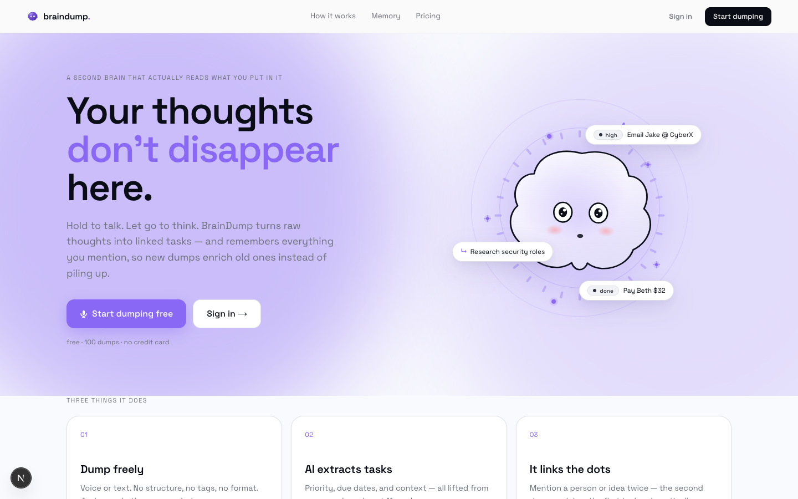
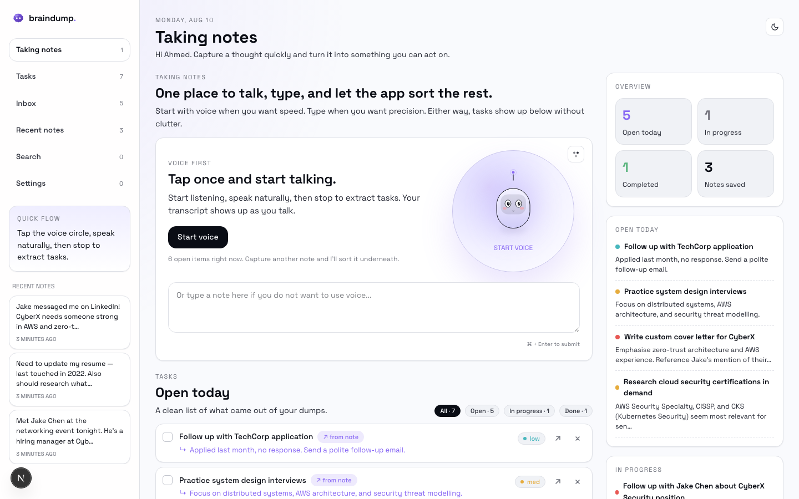
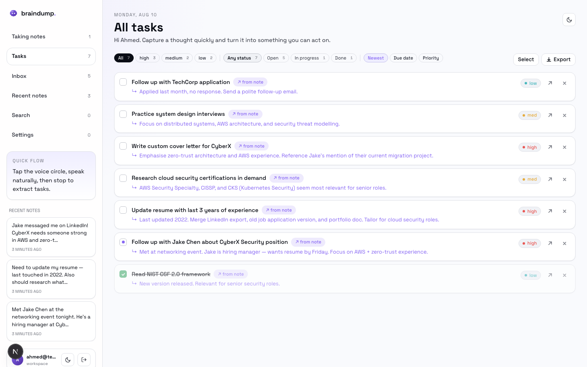
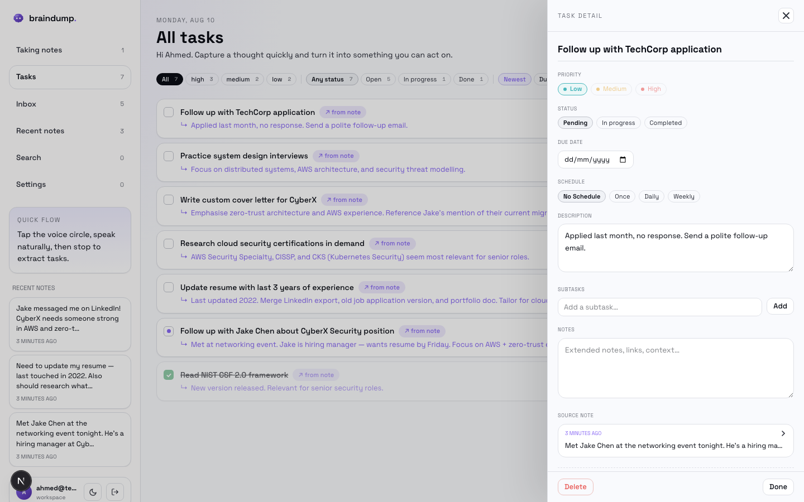
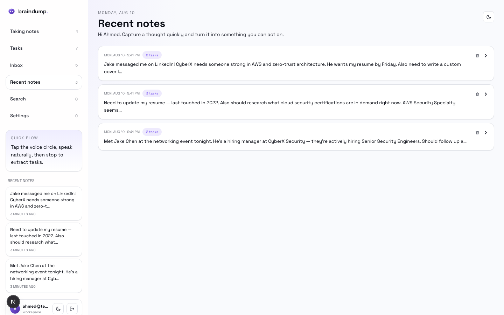

# BrainDump

> **Your thoughts don't disappear here.**
>
> Most apps make you organize as you go. BrainDump lets you dump everything raw — text or voice — and the AI does the organizing. But what's different: it remembers. Every dump, every task, every connection you've ever made lives in context. So when you mention someone you met, or an idea you had, the AI already knows what's open, what's related, and what needs updating.
>
> It's not a note app. It's not a task manager. It's a second brain that actually reads what you put in it.

---

## Screenshots

### Landing page


### Dashboard — capture zone


### All tasks view — with priority, status, and source note links


### Task detail panel — edit title, priority, subtasks, notes, due date


### Recent notes — each dump shows how many tasks it created


---

## What makes this different

Most note apps just store what you write. BrainDump is context-aware — when you dump a new thought, the AI already knows your existing pending tasks and recent dumps. So if you mention meeting someone who's a hiring manager, and you already have a task "Research security job opportunities", the AI links them — enriching the existing task rather than creating a duplicate.

**Example:** You dump *"Met Jake at the networking event, he's a hiring manager at CyberX"*. The AI sees you already have a pending task *"Research security job openings"*. Instead of creating a duplicate, it enriches the existing one: *"Research security job openings — contact Jake from CyberX (met at networking event)"*.

The AI uses a three-tier retrieval system to find relevant tasks:
1. **Vector search** (production) — cosine similarity via pgvector + BAAI/bge-small-en-v1.5 embeddings
2. **Full-text search** — keyword matching via PostgreSQL `tsvector`, always available as fallback
3. **Recency** — last N tasks by creation date, as a final safety net

---

## Features

| Feature | Details |
|---------|---------|
| **Dump freely** | Text or voice, no structure needed — just brain-dump and let the AI organize |
| **AI task extraction** | DeepSeek-V3 extracts tasks with priority, due dates, and context from your full history |
| **Cross-dump memory** | New dumps enrich existing tasks instead of creating duplicates |
| **Voice input** | Web Speech API (browser-native, zero cost) with HF Whisper fallback |
| **Task management** | Edit title, description, priority, status, due date, subtasks, notes, tags, schedule |
| **Task filtering & sorting** | Filter by priority/status, sort by newest / due date / priority |
| **Bulk actions** | Select multiple tasks, mark complete or delete in one click |
| **Export** | Download all tasks as CSV or JSON |
| **Search** | ⌘K global search across tasks and notes with keyword highlighting |
| **Notes view** | Every brain dump linked to the tasks it created — click to expand |
| **Semantic retrieval** | pgvector HNSW index surfaces relevant older tasks, not just the most recent |
| **Rate limiting** | 20 dumps/hour (DB-backed), 30 transcriptions/hour (in-memory) |
| **Auth** | Supabase Auth with session cookie refresh on every request |

---

## Tech stack

This is a single full-stack Next.js app — there is no separate backend server.

| Layer | Technology |
|-------|-----------|
| Frontend | React 19 + Next.js 16 App Router |
| UI | shadcn/ui (Radix UI) + Tailwind CSS v4 |
| Client data | SWR with optimistic updates |
| Backend | Next.js API Routes → Vercel serverless functions |
| AI (tasks) | `deepseek-ai/DeepSeek-V3-0324` via Hugging Face router |
| AI (voice) | `openai/whisper-large-v3` via Hugging Face (fallback) |
| Voice (primary) | Web Speech API — browser-native, free, no API call |
| Embeddings | `BAAI/bge-small-en-v1.5` (384-dim) via Hugging Face Inference API |
| Database | Supabase (PostgreSQL + pgvector) |
| Auth | Supabase Auth, JWT, cookie refresh via middleware |
| Hosting | Vercel |

---

## Database schema

```sql
brain_dumps
  id          uuid (PK)
  user_id     uuid (FK → auth.users)
  content     text
  created_at  timestamptz

tasks
  id             uuid (PK)
  user_id        uuid (FK → auth.users)
  brain_dump_id  uuid (FK → brain_dumps)
  title          text
  description    text
  priority       enum: low | medium | high
  status         enum: pending | in_progress | completed
  due_date       timestamptz
  subtasks       jsonb
  notes          text
  schedule_type  text
  scheduled_date timestamptz
  tags           text[]
  embedding      vector(384)      -- pgvector semantic search
  created_at     timestamptz
  updated_at     timestamptz      -- kept accurate by DB trigger

api_logs
  id                  uuid (PK)
  user_id             uuid
  brain_dump_id       uuid
  endpoint            text
  model               text
  content_length      int
  tasks_extracted     int
  enrichments_applied int
  duration_ms         int
  success             boolean
  error_message       text
  created_at          timestamptz
```

---

## Running locally

### 1. Clone and install

```bash
git clone https://github.com/ahmedthebutt/braindump.git
cd braindump
npm install
```

### 2. Environment variables

Create `.env.local`:

```env
NEXT_PUBLIC_SUPABASE_URL=your_supabase_project_url
NEXT_PUBLIC_SUPABASE_ANON_KEY=your_supabase_anon_key
HUGGINGFACE_API_TOKEN=your_hf_token
```

- **Supabase** — create a free project at [supabase.com](https://supabase.com). Get `SUPABASE_URL` and `SUPABASE_ANON_KEY` from Project Settings → API.
- **Hugging Face** — create a free account at [huggingface.co](https://huggingface.co) and generate a token in Settings → Access Tokens. One token covers all three models (DeepSeek-V3 for task extraction, Whisper for voice, BGE for embeddings).

### 3. Run database migrations

In the Supabase SQL editor, run these migrations in order:

```
supabase/migrations/001_task_enhancements.sql
supabase/migrations/002_updated_at_trigger_and_rls.sql
supabase/migrations/003_embeddings.sql
```

Migration 003 requires the `pgvector` extension (pre-installed on all Supabase projects). It adds the `embedding` column, HNSW index, and two RPCs (`match_tasks` for vector search, `match_tasks_fts` for keyword fallback).

### 4. Start the dev server

```bash
npm run dev
```

Open [http://localhost:3000](http://localhost:3000).

---

## How the AI pipeline works

```
User types or speaks a brain dump
        ↓
POST /api/extract-tasks
        ↓
Fetch context:
  • Last 5 brain dumps (recent history)
  • Up to 15 relevant pending tasks via three-tier retrieval:
      Tier 1: pgvector cosine similarity (embed dump → find nearest tasks)
      Tier 2: PostgreSQL full-text search (keyword overlap fallback)
      Tier 3: Most recent by created_at (last-resort baseline)
        ↓
DeepSeek-V3 prompt:
  STEP 1 — INVENTORY all items in the dump
  STEP 2 — CLASSIFY each as: new task / enrichment / subtask / not a task
  STEP 3 — OUTPUT: tasks[], enrichments[], subtask_additions[], summary
        ↓
Apply results:
  • tasks[]             → INSERT new rows into tasks table (with embedding)
  • enrichments[]       → UPDATE description of existing tasks
  • subtask_additions[] → PUSH new subtask into existing task's jsonb array
  • Log to api_logs
        ↓
Return to client → SWR mutate → task list re-renders
```

---

## Scripts

```bash
npm run dev               # Start dev server
npm run build             # Production build
npm run test              # Run unit tests (Vitest, 24 tests)
npm run test:story        # Run 8-chapter AI story integration test (real HF + Supabase)
npm run backfill:embeddings  # Embed all existing tasks that predate migration 003
```

---

## Test suite

The project has two test layers:

**Unit tests** (`npm run test`) — 24 tests covering rate limiting, Zod response schemas, dedup logic, and utility functions. Fast, no external calls.

**Story integration test** (`npm run test:story`) — feeds an 8-chapter job-search story to the real AI pipeline and evaluates intelligence: does it enrich existing tasks? avoid duplicates? handle extreme dumps with 10 items? link information across dumps? Last run: **95% (36/38 checks passed)**.

---

## Project structure

```
app/
  api/
    extract-tasks/route.ts   Core AI pipeline
    transcribe/route.ts      Voice → text via Whisper
    tasks/[id]/route.ts      PATCH + DELETE individual tasks
    tasks/batch/route.ts     Bulk complete + delete
    tasks/export/route.ts    CSV / JSON export
    brain-dumps/[id]/route.ts Delete dump + cascade tasks
  auth/                      Login, sign-up, callback pages
  dashboard/
    page.tsx                 Server component: auth check + SSR data
    dashboard-content.tsx    Client shell: SWR, views, capture
  page.tsx                   Landing page

components/
  capture-zone.tsx           Voice + text capture UI with mascot
  task-list.tsx              Task rows: status, priority, delete, open detail
  task-detail-panel.tsx      Slide-in edit panel
  error-boundary.tsx         React class error boundary

lib/
  embeddings.ts              HF embedding helpers (query + task embedding)
  rate-limit.ts              DB-backed + in-memory rate limiting
  supabase/
    server.ts                Server-side Supabase client (cookie-based)
    client.ts                Browser Supabase singleton

supabase/migrations/         SQL migrations (run in Supabase SQL editor)
__tests__/                   Vitest unit + story integration tests
scripts/                     CLI utilities (backfill, screenshots)
```
